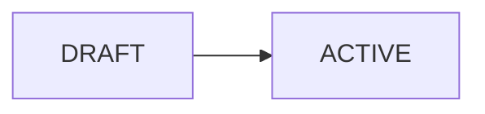

# Workflow: Crear proyecto

## 1. Objetivo
Dar de alta una obra con cliente, datos base y estado inicial.

## 2. Actor inicial
PM o ADMIN.

## 3. Precondiciones
- Existe **Contact** activo con rol CLIENT activo, dado de alta previamente en Directorio.
- Usuario con permiso EDIT en Proyectos.
- Módulo Proyectos habilitado y empresa válida según el contexto vigente.

## 4. Pasos
1. **Proyectos** → “Nuevo proyecto”.
2. Completar: código interno, nombre, cliente, ubicación, fechas, `project_type` PUBLIC/PRIVATE.
3. **Crear proyecto** → estado `DRAFT`. Bajo `MEMBERSHIP_SCOPED`, si el creador requiere asignación según sus roles, se incorpora su acceso únicamente a esa obra nueva en la misma transacción que la obra y la auditoría (D-111 / Q-067).
4. (Opcional) Adjuntar documentos iniciales ([`DOCUMENTS.md`](../02-modules/DOCUMENTS.md)).
5. **Activar** → revisar el diálogo **Activar obra** → **Confirmar** → estado `ACTIVE` (dispara `project.activated`).

## 5. Postcondiciones
- Proyecto listo para presupuesto y cronograma.
- El creador puede abrir la nueva obra dentro de sus permisos existentes. El roster de avisos D-091 es independiente del acceso.

## 6. Eventos generados
- `project.created`, `project.activated`.

## 7. Caminos alternativos / errores
- Código duplicado → conflicto recuperable, incluso ante altas simultáneas.
- Cliente inactivo o sin rol CLIENT activo → rechazo sin crear la obra; no se asigna un rol implícitamente.
- Fecha inválida o fin previsto anterior al inicio → error de validación. Vaciar una fecha opcional al editar la elimina.
- Falla al guardar la auditoría o la asignación del creador → se deshace el alta completa.

## 8. Diagrama

## Referencias
- [`../02-modules/PROJECTS.md`](../02-modules/PROJECTS.md)
