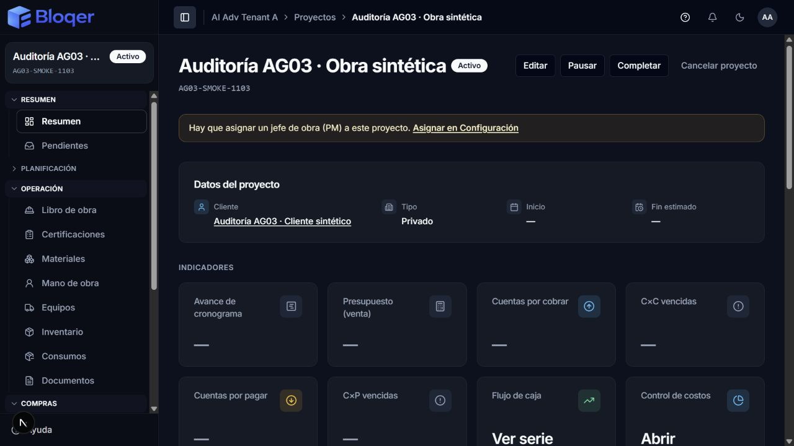
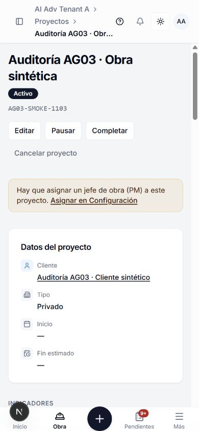

# AG-03 — Directorio y proyectos

**03/11/2026 · Corregida y verificada en código, SQL y navegador aislado.** Veinte grupos de hallazgos resueltos, 1.972 pruebas generales y 45 casos SQL aprobados. AG-04 espera indicación del Owner.

## 1. Encargo y base

El Owner autorizó corregir todos los hallazgos confirmados del lote y verificar antes de continuar. Durante la corrida aclaró que los roles siguen siendo relevantes, sugirió evaluar una simplificación y pidió preservar lo que funciona. Aprobó expresamente [Q-067: acceso del creador únicamente a la obra nueva](./2026-11-03-ag-03-project-creator-proposal.md); la simplificación general queda como [propuesta separada](./2026-11-03-role-simplification-proposal.md), sin implementación.

- Rama `codex/pruebas`, HEAD `3b5ae7a038465ad6b3d60cde19c278a31019e165`.
- Base real: [foto inicial](../../../../output/platform-audit/ag-03-2026-11-03/initial-snapshot.json), con estado Git y SHA-256 de 2.479 archivos antes de modificar AG-03. El árbol ya contenía AG-00/01/02 y trabajo INDARI ajeno. Un diff completo contra HEAD no representa exclusivamente este lote.
- Cambios finales y archivos ajenos preservados: [manifiesto](../../../../output/platform-audit/ag-03-2026-11-03/final-manifest.json). Los hashes permiten atribuir archivos modificados; no reconstruyen el contenido anterior de archivos que ya estaban sucios.
- Ejecución SQL y navegador: base sintética `bloqer_audit_ag01_20261103`, sobre el compute de desarrollo verificado por cada suite. Ambas URLs explícitas y comprobación `current_database()` antes de escribir. Nunca se ejecutó sobre la base operativa o producción.
- Navegador local autorizado previamente por el Owner; misma base aislada, sin proveedores externos habilitados. [Identidad](../../../../output/platform-audit/ag-03-2026-11-03/database-identity.json) y [entorno local](../../../../output/platform-audit/ag-03-2026-11-03/local-environment.json).
- Sin cambios de schema/migraciones, dependencias, estados, fórmulas financieras ni roles canónicos. Sin commit, push o despliegue en esta ejecución.

La skill `bloqer-platform-audit` coordinó tres agentes: Directorio/datos; Proyectos/contratos; UI/recorridos. Luego se dividió la coordinación con compras y finanzas por archivos y hubo revisión cruzada. Root integró fuentes, decisiones, accesibilidad compartida, documentación, SQL y navegador. Se respetó un responsable por archivo.

## 2. Fuentes y alcance

Fuentes principales: [Directorio](../../02-modules/DIRECTORY.md), [Clientes](../../02-modules/CLIENTS.md), [Proveedores](../../02-modules/SUPPLIERS.md), [Subcontratistas](../../02-modules/SUBCONTRACTORS.md), [Proyectos](../../02-modules/PROJECTS.md), [crear proyecto](../../05-workflows/CREATE_PROJECT.md), estados, BR-DIR/CLI/PROJ, D-053, D-090, D-091, D-111 ACL y ADR-018. Se contrastaron schema/relaciones, matriz §§9.1/9.5, service layer, aislamiento y política de impacto documental/AI.

Recorridos revisados:

- `/directorio`: búsqueda, filtros, paginación, tabla/tarjetas, exportación de página, alta/ficha/edición, archivo/reactivación, roles comerciales y tres perfiles. Se siguieron Actions, schemas, servicios, auditoría y selectores consumidores.
- `/proyectos`: listado, alta, edición, cliente histórico, fechas, código/tipo, equipo de avisos, impacto de cancelación y transiciones. Se incluyeron pertenencia, module gates, lectura e invalidación.
- Conexiones demostradas: bloqueo de tipo frente a aprobación de presupuesto; historial de presupuesto con ACL; ciclo de vida frente a certificaciones, PR/PO/cotizaciones/adjudicaciones, activación de subcontrato, AR/AP, NC/ND, cobros y pagos. Se adaptó la coordinación dentro de las transacciones; no se auditó íntegramente la lógica interna de esos módulos.
- UI compartida: selector IVA con `FormControl`, cabeceras, campos de ficha y disposición móvil de acciones/breadcrumbs. Es una muestra declarada de componentes afectados, no cobertura visual de toda la plataforma.

El código actual accede a Prisma desde servicios, conforme al estado documentado de la arquitectura; no se inventó una capa de repositorios ni se movió lógica financiera a React. Los montos de crédito y DTO usan el kernel monetario. El aislamiento de perfiles sigue el padre obligatorio del catálogo ADR-018.

## 3. Evidencia de recorridos

**Directorio:** se crearon datos sintéticos por la UI; un CUIT incompleto mostró error asociado; la escritura válida normalizó separadores y conservó IVA. Se guardaron crédito/notas, se vaciaron y se reabrió el perfil para comprobar el borrado. Archivo, búsqueda del archivado y reactivación funcionaron. El smoke reprodujo la pérdida de filtros ante cambios rápidos; tras corregirla, la URL conservó `status=ALL` y la búsqueda fiscal formateada, con el contacto archivado encontrado. Las pruebas SQL agregan unicidad histórica, concurrencia, separación tenant, roles/perfiles e historial.

**Proyectos:** alta por UI con cliente del Directorio; fin anterior al inicio rechazado y enfocado; intervalo válido guardado; ambas fechas vaciadas desde edición y leídas como `—` en el resumen; activación de la obra sintética. Las suites SQL cubren además pausa/reanudación, cancelación y reactivación, cierre, bloqueo por documentos, legado histórico y rollback por fallo de auditoría. El PM en modo por asignación puede abrir solo su nueva obra tras Q-067; una obra ajena sigue denegada.

**Concurrencia:** pruebas mantenidas ejecutan cuerpos reales de servicios con intercalados controlados. Las SQL observan `pg_blocking_pids` y usan escrituras reales en ambos órdenes. Se confirmó un `40P01` al cambiar código mientras se administraba ACL; la misma prueba pasa después de ordenar los locks. Se distinguieron estos resultados de los tests sin DB que comprueban punto de revalidación y orden de operaciones.

## 4. Hallazgos y correcciones

Los siguientes IDs consolidan causas y consumidores; no cuentan cada función como un defecto distinto. Salvo indicación contraria, se trata de desvíos preexistentes confirmados en el código inicial. Todos están corregidos en fuente; la verificación final se detalla en §6.

1. **GA-AG-03-001 · P1 · Directorio no aplicaba su módulo habilitado y exponía acciones a lectura.** Gates en servicios y alta/edición directa; CTA y perfiles siguen `EDIT DIRECTORY` agregado vigente. Se conservan los roles y la granularidad actual de matriz §9.1.
2. **GA-AG-03-002 · P2 · CUIT/CUIL admitía formatos inválidos, duplicados equivalentes y búsquedas inconsistentes.** Formato de 11 dígitos, normalización, consulta mínima por tenant sobre históricos, índice único para carreras y conflicto recuperable. No se impuso checksum ni se reescribieron históricos/IDs extranjeros.
3. **GA-AG-03-003 · P1 · Contactos podían persistir sin auditoría o pisar cambios simultáneos.** Nueve mutaciones confirman datos y log por `tx`, snapshots y condiciones de versión/estado. Se prueba rollback real al fallar el FK del actor.
4. **GA-AG-03-004 · P2 · Perfiles permitían rol inactivo y no borraban campos opcionales.** Contacto/rol activos revalidados bajo lock, null explícito, crédito no negativo y 2 decimales; reactivación conserva el perfil histórico. UI bloquea duplicados y oculta cambios de roles/perfiles en contactos archivados.
5. **GA-AG-03-005 · P2 · Selectores y paginación podían omitir contactos o aceptar offsets inválidos.** Se eliminó el corte silencioso de 10.000, se estabilizó orden y se validan página/offset/búsqueda en los servicios y URLs. Prueba con 10.001 contactos sin DB.
6. **GA-AG-03-006 · P2 · Fechas inválidas se descartaban y no se podían limpiar.** Schemas rechazan fechas inválidas, conservan null explícito y comparan inicio/fin, incluso con actualizaciones parciales. Completar compara fin real con inicio.
7. **GA-AG-03-007 · P1 · Metadatos y transiciones de obra no eran atómicos y perdían cambios.** CAS de estado/versión, auditoría en la misma transacción, snapshots, conflicto de código concurrente y estado previo de cancelación correcto. Durante esta corrección, la suite detectó que el límite por defecto de 5 s era insuficiente para las comprobaciones dentro de `tx`; se ajustó a los límites acotados ya usados en operaciones similares (espera 10 s, transacción 30 s).
8. **GA-AG-03-008 · P1 · Lecturas auxiliares omitían autorización del proyecto.** Impacto de cancelación y equipo aplican módulo/ACL antes de leer; historial de presupuesto aplica el mismo acceso a la obra antes de exponer comentarios/actores. Se prueban accesos denegados sin consultar el detalle.
9. **GA-AG-03-009 · P2 · Equipo consideraba activa una cuenta global inactiva.** Picker, altas, aviso de supervisor y fan-out requieren cuenta y membresía activas. Altas/bajas del roster auditan atómicamente; el roster continúa separado del ACL.
10. **GA-AG-03-010 · P2 · Reactivación legacy confundía ausencia de bloqueantes con ausencia de historia.** Se cuentan actividades históricas independientemente del estado; se conserva el estado previo guardado y el fallback BR-PROJ-006 vuelve a pausa con actividad/inicio, o a borrador sin ellos.
11. **GA-AG-03-011 · P1 · Cancelación podía competir con la creación/emisión de un bloqueante.** Revalidación del estado bajo el mismo lock de Project al comienzo de las transacciones afectadas, antes del documento/empresa. Cancelación cuenta por `tx` bajo ese lock. Incluye certificación, compras/subcontratos y 22 entradas AR/AP/tesorería; las reversiones conservan sus reglas previas.
12. **GA-AG-03-012 · P1 · Tipo de obra podía cambiar mientras se aprobaba un presupuesto.** Metadata y aprobación coordinan Project; aprobación relee las condiciones bajo Project→Budget. También se alinearon creación/edición/transiciones de esos servicios con auditoría transaccional. No se cambian cálculos financieros.
13. **GA-AG-03-013 · P1 · Locks nuevos podían invertir FK con administración de ACL.** Detectado y corregido durante AG-03: Project usa `NO KEY UPDATE`; payload con `code` toma antes Tenant `KEY SHARE` para su posible elevación de lock. La prueba SQL idéntica antes/después confirma la eliminación de `40P01`, junto con exclusión y CAS entre dos escritores.
14. **GA-AG-03-014 · P2 · Quitar CLIENT y vincular una obra no coordinaban su comprobación.** Contact compartido con relectura por `tx` en alta/cambio y baja del rol; ambos órdenes se prueban sobre SQL. Se corrigió además la restricción histórica preexistente que bloqueaba quitar CLIENT por una obra completada: referencias y perfil de obras terminales se preservan.
15. **GA-AG-03-015 · P2 · Creador sin acceso a la nueva obra en modo por asignación.** Q-067 aprobada: ProjectMembership solo para el creador y esa obra, cuando lo requieren modo/roles, en la misma transacción de creación. Sin roles extra ni asignaciones históricas; modo fresco bajo lock y cachés invalidadas.
16. **GA-AG-03-016 · P2 · Filtros perdían estado al seleccionar Todos o cambiar rápido.** `ALL` explícito y borrador de URL acumulado en Directorio/Proyectos, con búsqueda pendiente y respuestas intermedias; navegación externa reinicia el borrador. Reproducción real y nueve regresiones de navegación.
17. **GA-AG-03-017 · P2 · Guardados y confirmaciones fallidos no siempre permitían recuperar el intento.** Formularios, equipo, perfiles y lifecycle capturan rechazos, muestran mensajes, evitan doble envío y permiten reintento. Impacto de cancelación permite Reintentar e ignora respuestas de un diálogo anterior.
18. **GA-AG-03-018 · P2 · Lecturas quedaban desactualizadas tras mutar.** Alta de proyecto, perfiles y lifecycle revalidan sus consumidores; el shell invalida su caché tras una transición exitosa. Pruebas de invalidación y lectura posterior en navegador/SQL.
19. **GA-AG-03-019 · P2 · Controles/ficha y acciones móviles tenían diferencias o recortes.** Ficha usa encabezado, badge y grilla compartidos; selector IVA transmite ref/id/onBlur/ARIA a su trigger. En 390 px Editar medía x=-42,875: el grupo ahora se contrae y envuelve. La cabecera admite altura de breadcrumbs sin recortar el tenant en móvil; aplicada la misma disposición a su consumidor de plataforma. Sin nuevos flujos/etiquetas de negocio por estos cambios cosméticos.
20. **GA-AG-03-020 · P2 · CSV sugería un alcance mayor que el real.** Directorio y Proyectos dicen Exportar página CSV; roles comerciales exportados en español. Crédito serializado con el kernel de 2 decimales. Guía/Ayuda aclaran el alcance paginado.

## 5. Cambios, documentación y asistencia

El [manifiesto](../../../../output/platform-audit/ag-03-2026-11-03/final-manifest.json) registra archivos y hashes, separados del trabajo anterior. No se modificaron los planes INDARI ni sus servicios de conciliación de factura/OC.

Se actualizaron en el mismo lote [Guía §§3/5.1/8.1](../../GUIA_OPERATIVA_BLOQER_V2.md), artículos de Directorio y puesta en marcha, Clientes/Directorio/Proyectos, workflow de alta, service layer, Q-067 y la enmienda D-111 ACL. Los apartados **Hallazgo** reconcilian el ACL vigente y el permiso agregado de Directorio sin convertir granularidad futura en una regla actual.

Bloqer AI: tools `search_projects` y `get_project_summary` continúan reutilizando services/ACL; no cambian parámetros, permisos ni política del modelo. No hay tool de mutación de contactos/proyectos que adaptar. Knowledge se regeneró y comprobó con las nuevas instrucciones de Guía/Ayuda. No se llamó a modelos externos ni se presentaron evaluaciones en vivo como realizadas. Ajustes puramente de clases y forwarding accesible: sin impacto documental/AI adicional.

## 6. Verificación

### Aprobada

- **1.972 pruebas unitarias/de contratos** en nueve paquetes, cero fallos. Incluye 218 casos adicionales frente a AG-02. [Log](../../../../output/platform-audit/ag-03-2026-11-03/workspace-test.log) y [desglose](../../../../output/platform-audit/ag-03-2026-11-03/unit-test-summary.json).
- **13 typechecks**; ESLint de paquetes y web sin advertencias. [Tipos](../../../../output/platform-audit/ag-03-2026-11-03/workspace-typecheck.log), [lint](../../../../output/platform-audit/ag-03-2026-11-03/workspace-lint.log). Las últimas clases se vuelven a comprobar con lint/tipos de web; el ajuste transaccional tiene 39 regresiones de Project y tipos de services aprobados.
- **45 casos SQL aprobados, cuatro suites:** Directorio 20/20, Contact↔Project 3/3, compatibilidad de locks/ACL 3/3 y Proyectos 19/19. La primera [corrida conjunta](../../../../output/platform-audit/ag-03-2026-11-03/live-final.log) aprobó 44/45; después del ajuste de tiempo se repitió toda la suite funcional de Proyectos, **19/19 aprobados**, cero omitidos ([revalidación final](../../../../output/platform-audit/ag-03-2026-11-03/project-live-after-timeout.log)). Son 45 casos distintos; no se suman las repeticiones como casos nuevos.
- **Knowledge:** 517 chunks, comprobación de frescura aprobada. [Log](../../../../output/platform-audit/ag-03-2026-11-03/ai-check-docs-index.log).

Comandos: `pnpm run test --force --concurrency=2`, `pnpm run typecheck --force --concurrency=2`, `pnpm run lint --force --concurrency=2`; suites SQL explícitas con `BLOQER_AUDIT_LIVE=1` y guard de base; `pnpm ai:index-docs` + `pnpm ai:check-docs-index`. No se usó build, porque el build raíz puede alcanzar migraciones.

### Fallos encontrados y tratamiento

El caso SQL de `code key edit` reprodujo `40P01` antes del fix ([baseline](../../../../output/platform-audit/ag-03-2026-11-03/code-key-lock-baseline.log)); pasa en la corrida conjunta después del fix. En esa corrida, el caso funcional de cancelación agotó 5.000 ms (5.192 ms medidos); se corrigieron los límites y pasó junto con los otros 18 casos en la repetición final. No quedaron fallos pendientes de estas verificaciones. Los errores FK/NUL provocados a propósito por las pruebas verifican rollback; no se contabilizan como errores residuales del producto.

### Omitida / no ejecutada

El runner unitario omitió **17 suites live** por sus flags; sus casos internos no se incluyen en 1.972 ni se confunden con el resumen `skipped=0` de tests hoja de Node. Cuatro suites AG-03 se ejecutaron separadamente sobre la base aislada; las otras 13 no se repitieron en esta fase. E2E completos de módulos financieros, archivos/R2, correo real, OpenAI en vivo, rendimiento de producción, migraciones, despliegue y smoke del portal no se ejecutaron. Las etapas siguientes siguen pendientes de su auditoría funcional completa.

### Navegador

Se comprobó con cuenta sintética OWNER el recorrido descrito en §3, en escritorio 1280×720 oscuro, 390×844 claro/oscuro y 320×740 oscuro, con DOM medido. VIEWER consultó listado y ficha de Directorio sin alta, edición, archivo ni gestión de roles/perfiles visibles; la URL directa de edición lo devolvió a la ficha de lectura. Pantallas y archivos de prueba son sintéticos; capturas en [evidencia local](../../../../output/platform-audit/ag-03-2026-11-03/screenshots/). Q-067 y usuarios suspendidos se prueban sobre SQL; no se presenta como navegación de cada rol. Los tests sin DOM de recuperación no sustituyen lector de pantalla, auditoría WCAG completa o todos los dispositivos. Plataforma compartió la corrección de altura de cabecera por inspección de su consumidor; no se repitió su smoke en AG-03.

Referencias visuales conservadas con el informe: escritorio oscuro 1280×720 y móvil claro 390×844, después de corregir las acciones y la altura de cabecera. El roster vacío es deliberado en esta obra sintética; no se asignaron usuarios desde el navegador ni se alteró su acceso para producir las capturas.

## 7. Revisión independiente

Directory revisó Project/Budget/Certification y luego los seis servicios de compras/subcontratos. Frontend revisó Contact/validator, los nueve servicios AR/AP/Collection y después selector fiscal/documentación. Detectaron la carrera CLIENT y se corrigió coordinadamente. Root comprobó reproducciones, SQL, fuente, accesibilidad y visuales; el smoke detectó filtros rápidos y recortes que las pruebas aisladas no cubrían. Las revisiones no acreditan cobertura integral de módulos vecinos ni atribuyen a AG-03 bloques históricos movidos.

## 8. Cierre y reutilización

AG-03 se cierra en el alcance anterior, corregida y verificada localmente. Código, SQL y smoke visual tienen evidencia separada; no se declara publicada. Se espera indicación para **AG-04 — Presupuestos, EDT/WBS, APU y adendas**.

Para reauditar solo un área: usar la misma skill/runbook y la foto de revisión del cambio; Directorio reabre los hallazgos GA-AG-03-001 a 005, 014, 016 y 020 y sus selectores; metadata/lifecycle reabre GA-AG-03-006 a 018 y los consumidores de estado/tipo/ACL; una modificación de los locks requiere reabrir las suites de intercalado y SQL real. Los IDs se conservan al revalidar; no se crea una copia nueva del hallazgo.

La simplificación de roles sigue en [Q-024 y su propuesta](./2026-11-03-role-simplification-proposal.md). No hay preguntas de negocio pendientes para las correcciones adoptadas en este lote. Publicación y comprobación de la versión publicada siguen siendo una acción distinta.
