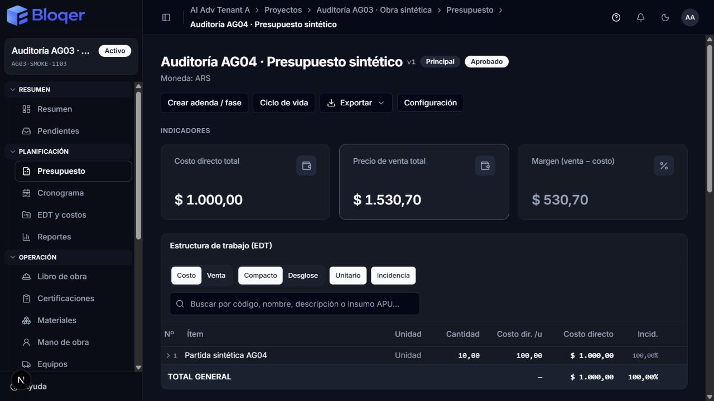
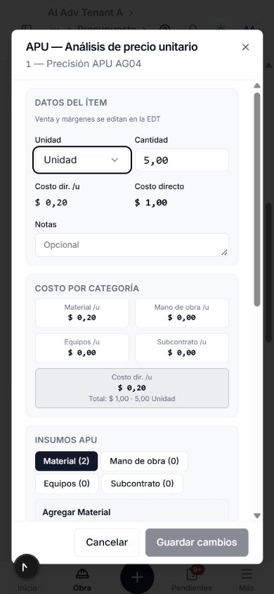

# AG-04 — Presupuestos, EDT, APU y adendas operativas

## 1. Encargo y base

Auditoría y corrección autorizada por el Owner, iniciada el 03/11/2026 y finalizada el 04/11/2026. Se conserva el alcance incremental del [plan](../PLATFORM_AUDIT_PLAN.md) y el [procedimiento](../PLATFORM_AUDIT_RUNBOOK.md). **No se inicia AG-05.**

- Rama `codex/pruebas`; HEAD `3b5ae7a038465ad6b3d60cde19c278a31019e165`, sin commit/push/deploy en esta corrida.
- Baseline real: `output/platform-audit/ag-04-2026-11-03/initial-snapshot.json`, con hashes de 2.499 archivos y estado inicial. El árbol incluía AG-00 a AG-03 y trabajo INDARI ajeno; el diff completo contra HEAD no es atribuible a AG-04.
- Atribución final: `final-manifest.json` en esa carpeta. Se preservan las cuatro fuentes INDARI identificadas en el baseline. Las modificaciones de schema son comentarios sobre el índice D-116 existente; no hay migración ni campos nuevos.
- Especialistas: `ag04_budget` (ciclo, políticas, cálculo y validators), `ag04_wbs` (estructura, APU, importación e integridad), `ag04_frontend` (pantallas, Actions y contratos). Root coordinó exportación exacta, vínculo con cronograma, SQL real, navegador, documentación y revisión. Un escritor por archivo; revisiones posteriores de colegas sin editar simultáneamente.
- Entorno: instancia local `http://localhost:3100`, con la base sintética aislada `bloqer_audit_ag01_20261103` en el compute de desarrollo previamente verificado. Cada suite SQL comprueba URLs e identidad efectiva antes de crear sus propios fixtures. Email, storage, IA externa y tareas reales deshabilitados. No se usó producción ni se modificaron archivos `.env`.

## 2. Fuentes y alcance

Fuentes funcionales: [BUDGETS](../../02-modules/BUDGETS.md), [WBS_AND_COST_ITEMS](../../02-modules/WBS_AND_COST_ITEMS.md), [CONTRACTS_AND_ADDENDUMS](../../02-modules/CONTRACTS_AND_ADDENDUMS.md), [CHANGE_ORDERS](../../02-modules/CHANGE_ORDERS.md) y, para el vínculo demostrado, [PROJECT_SCHEDULING](../../02-modules/PROJECT_SCHEDULING.md). Se contrastaron schema, índices existentes, estados, permisos, company scoping y el catálogo cerrado de aislamiento ADR-018.

Decisiones aplicadas: D-002/D-005/D-030 (versiones y estados), D-042 (planificación en obra DRAFT/ACTIVE), D-047/D-053 (APU y dinero), D-057 a D-060 (partida/insumo, ejes EDT e incidencia), D-073 (costo financiero), D-088 (edición excepcional), D-111 (ACL), D-116 (principal más adendas) y D-121, aprobada en esta fase. Fórmulas: [presupuesto](../../04-formulas/BUDGET_FORMULAS.md), [venta](../../04-formulas/SALE_PRICE_FORMULAS.md), [costo](../../04-formulas/COST_FORMULAS.md), [Money Model](../../03-finance/MONEY_MODEL.md).

### Inventario reconciliado

- **Documentado e implementado:** Budget versionado, BudgetSettings, padre/adenda, WbsNode, CostItem, CostAnalysisLine, ciclo de vida y políticas D-088. Persistencia real mediante Prisma desde services; no se inventan repositorios para describir una capa inexistente.
- **Expuesto:** listado, alta, adenda y detalle en `/proyectos/[id]/presupuestos`; Actions en esa carpeta; formularios bajo `features/budgets`; exportaciones CSV/XLSX/PDF/JSON mediante la ruta de reports. Se conectó la edición de nombre/notas ya implementada que no tenía consumidor visible.
- **Consumidores incluidos por dependencia:** resumen del proyecto y selección del principal; costos/materiales/reportes e invalidación; importación del presupuesto al cronograma. Las certificaciones se incluyen para proteger cantidad ya certificada y vínculos históricos, sin reauditar su workflow completo.
- **Fuera de implementación:** entidades legales Contract/Addendum/ChangeOrder, comparación/versionado contractual y plantillas futuras. [Q-057](../../00-product/OPEN_QUESTIONS.md#q-057--módulo-contract--addendum--changeorder-entidades-legales) sigue diferida. La adenda operativa es un Budget hijo; no se construyó un módulo legal por inferencia.

### Dimensiones y límites

Se revisaron tenant, empresa propia/compartida, proyecto, roles actuales y gates; entradas, DTO, precisión, transacciones, rollback, concurrencia y referencias; interacción y accesibilidad de formularios; lecturas posteriores, exportación y ayuda. No se simplificaron roles. No se enviaron emails ni se cargaron archivos a servicios externos. Las mediciones de volumen corresponden al entorno sintético remoto y no son un benchmark de producción. El smoke visual es una muestra, no una certificación WCAG ni cobertura de todas las rutas.

## 3. Evidencia de recorridos

### Crear, revisar y complementar

`budget-form.tsx` → `createBudgetAction` → schemas de `validators/src/budget.ts` → `createBudget` → Project/Budget/Settings/AuditLog. El servicio relee proyecto, padre y parámetros dentro de la transacción; asigna versiones sin colisión. La página fija el proyecto de la ruta y el servidor conserva la autorización real. Si falla la importación posterior, se conserva el ID creado y se reintenta solo la EDT.

Envío/devolución/reenvío/aprobación/cierre pasan por el servicio, validan estado actual y registran el evento atómicamente. Aprobar exige unidad, cantidad positiva y APU por partida; los placeholders de una importación permanecen editables en borrador. D-116 permite aprobar adendas manteniendo el principal aprobado; un segundo principal aprobado sigue bloqueado.

### EDT, APU y parámetros

`wbs-tree`/modales → Actions → schemas → servicios WBS/CostItem/CostAnalysis/Settings → locks **Tenant SHARE → Project NO KEY UPDATE → Budget UPDATE** para economía. El orden estabiliza ambos flags D-088 y el estado de la obra/presupuesto. Datos críticos se releen en `tx`, y la auditoría pertenece a esa misma transacción. No se adquiere Tenant después de Project.

Se validan árbol, perfiles de códigos, padre, profundidad y conjunto completo al reordenar. Renombrar un capítulo actualiza descendientes. Borrar/reemplazar/subdividir comprueba los nueve vínculos WBS y referencias de insumos APU usados por compras; no elimina historia para hacer pasar un cambio.

El recurso total conserva `partidaQuantity`; la cantidad y el aporte se recalculan con la cantidad actual del ítem. La composición nueva usa operandos de cuatro decimales y aporte monetario de dos. Motor y preview comparten helpers puros de APU y venta, sin llevar persistencia al cliente. Abrir una línea histórica no la regulariza; cuando un próximo guardado recalcula aportes, la UI anticipa ese resultado.

### Importación y exportación

El lector conserva texto Excel formateado (`11.10`) y CSV con comillas escapadas, saltos de línea, BOM y delimitadores fuera de campos citados. El servidor valida el archivo nuevamente y el modo estructural descarta datos económicos inyectados. Como no existe append, la preview valida el archivo independientemente del árbol que será reemplazado; ejecutar exige confirmación explícita y referencias protegidas bajo lock.

La importación estructural de **501 nodos y 500 ítems** se comprobó con **dos escrituras por lotes**, en **5.103 ms** medidos en esa ejecución. El modo completo también se compara contra el recálculo canónico. Exportación comparte métricas exactas en strings: conserva dinero, cantidades, ejes Costo/Venta, Unitario e Incidencia; excluye filas visuales APU. CSV/XLSX/PDF usan la misma tabla; JSON autenticado también lleva `private, no-store`.

### Presupuesto → cronograma

`importScheduleFromBudget` valida PROJECTS/SCHEDULE/BUDGETS y empresa del presupuesto, incluso bajo obra compartida. Dentro de la transacción toma Project → Budget, relee presupuesto/árbol/vínculos y guarda creación de Schedule, baseline, tareas, vínculos y auditoría. Dos solicitudes concurrentes no duplican tareas; fallar la auditoría revierte también el baseline. Cambiar la base a un presupuesto vacío igualmente registra evento con antes/después.

Los UUID se asignan antes de **dos createMany** para conservar padres y reducir viajes. Se verificaron **503 tareas con sus vínculos** en **6.651 ms** medidos en esa ejecución. Este arreglo no acredita el resto de Cronograma, que corresponde a AG-05.

## 4. Hallazgos y situación final

Los siguientes **28 grupos** quedan corregidos y verificados en su alcance local. IDs estables para futuras revalidaciones; las regresiones concretas se ubican en las suites citadas en §6 y en el registro JSON compañero. El origen es previo al baseline de AG-04 salvo los matices expresos.

1. **GA-AG-04-001 · P1 · Lecturas y servicios omitían alcance/gates.** Budget bajo obra compartida podía cruzar empresa; árbol/ensure/preview omitían ACL, permisos o módulo. Guards reales antes de exponer o mutar; propias y compartidas conservan su semántica.
2. **GA-AG-04-002 · P1 · Datos precargados permitían editar tras un cambio concurrente.** Relectura bajo los locks coordinados de tenant, obra y presupuesto; incluye baseline y revocación de D-088 en ambos órdenes.
3. **GA-AG-04-003 · P1 · Auditoría posterior al commit.** Parámetros, flags y mutaciones EDT/APU ahora se guardan junto a su evento; falla inducida de AuditLog comprueba rollback real.
4. **GA-AG-04-004 · P2 · Creación/adenda usaba padre, moneda o parámetros anteriores al lock.** Relectura e herencia correctas; versiones simultáneas únicas y principal/adenda conforme D-116.
5. **GA-AG-04-005 · P2 · Aprobación admitía partidas importadas incompletas.** Se bloquean cantidad cero/unidad vacía; no se impide crear el placeholder de borrador documentado.
6. **GA-AG-04-006 · P2 · Árbol y códigos podían quedar inconsistentes.** Formato, padre, profundidad, perfil, renombre de descendientes, numeración con huecos y reordenamiento completo atómicos.
7. **GA-AG-04-007 · P1 · Protección incompleta de historia al borrar/reemplazar.** Nueve vínculos WBS y hints APU protegidos, incluidos consumos del libro; rechazo sin desvincular documentos.
8. **GA-AG-04-008 · P1 · Referencias de producto/proveedor APU sin pertenencia.** Catálogo propio/compartido según empresa y comprobación de proveedor válido; IDs de otros tenants/contextos rechazados.
9. **GA-AG-04-009 · P2 · Listas APU aceptaban IDs duplicados/ajenos o eliminaciones ignoradas.** Validación completa y rollback del conjunto; un `_delete` no elude pertenencia ni referencia histórica.
10. **GA-AG-04-010 · P2 · Cantidad de partida podía recalcular con datos viejos o perder dinero legacy.** Cantidad fresca, piso certificado y conservación del recurso; lump histórico con `partidaQuantity = null` también se recalcula.
11. **GA-AG-04-011 · P2 · APU mostrado y próximo guardado discrepaban.** Helper puro común, sin doble redondeo; contempla legacy, cantidad inicial cero e insumo todavía sin Agregar. La diferencia de dos recursos `0,52 / 5` fue detectada durante esta remediación al alinear el servidor a dos decimales y se corrigió antes del cierre.
12. **GA-AG-04-012 · P2 · Márgenes duplicaban una fórmula float global.** Cascada común por unitario/partida y suma posterior; preview y resultado persistido coinciden.
13. **GA-AG-04-013 · P2 · Valores finitos podían exceder Decimal(18,4).** Se comprueba la capacidad física después del redondeo, en entrada y derivados, con VALIDATION y rollback; sin clamp ni regla financiera nueva.
14. **GA-AG-04-014 · P2 · Rollups/exportación perdían centavos.** Agregación exacta, cantidades preservadas y porcentaje half-up sin redondeo intermedio; DTO monetario display conservado.
15. **GA-AG-04-015 · P2 · Importación estructural aceptaba economía o árbol inválido.** El servidor verifica forma, unicidad, padres, perfiles y vacío; estructura solo produce placeholders.
16. **GA-AG-04-016 · P2 · CSV alteraba nombres y filas.** Parser de registros citados/escapados y delimitador correcto; XLSX conserva el código formateado.
17. **GA-AG-04-017 · P2 · Importación hacía viajes por nodo y pequeñas ediciones agotaban cinco segundos.** Batches y plazos explícitos. El primer smoke APU reprodujo expiración a 6.025 ms; la operación revirtió y pasó después del arreglo.
18. **GA-AG-04-018 · P2 · Preview impedía reemplazar el mismo archivo.** Validación del archivo sin colisionar con la estructura que será sustituida; confirmación de reemplazo obligatoria y ejecución protegida.
19. **GA-AG-04-019 · P2 · UI ofrecía acciones que el servidor rechazaba.** Permisos EDIT/APPROVE, estados y condición de la obra; URL de creación restringida, capítulos con bloqueo de estructura y lectura sin ensure mutante.
20. **GA-AG-04-020 · P2 · Doble envío, rechazo y cierre en vuelo.** Ref inmediata y estado pendiente compartido por el área; edición/cierre bloqueados, error recuperable y contenido conservado.
21. **GA-AG-04-021 · P2 · Alta parcial/importación podía duplicar presupuestos.** ID creado conservado, reintento de importación independiente; archivos nuevos invalidan precarga vieja y bloquean Crear mientras se leen.
22. **GA-AG-04-022 · P2 · Insumo sin Agregar podía perderse al guardar APU.** Aviso explícito y conservación de la edición; futuras cifras usan el mismo aporte que se enviará.
23. **GA-AG-04-023 · P2 · Lecturas derivadas quedaban obsoletas.** Invalidación de lista, detalle y consumidores de costos/finanzas; la creación usa el projectId vinculado por la página.
24. **GA-AG-04-024 · P2 · Notas guardadas no tenían lectura/edición visible.** Datos del presupuesto expone nombre/notas y Action existente. CLOSED envía solo notas y conserva incluso nombres legados no válidos para altas nuevas; esta última regresión del schema nuevo fue detectada y corregida en la fase.
25. **GA-AG-04-025 · P2 · Controles sin nombre o acceso por teclado.** Labels, ids, estados de toggles, botones de icono y apertura nativa de capítulo/APU; formularios de parámetros se acomodan en móvil con componentes existentes. El smoke detectó además que el fieldset del refactor desplazaba el título/acciones del APU móvil: se separó el div de scroll del fieldset y se recapturó correctamente en 390×844.
26. **GA-AG-04-026 · P2 · JSON de export autenticado sin política de caché equivalente.** `private, no-store`, como las otras representaciones.
27. **GA-AG-04-027 · P1 · Importación a cronograma dejaba baseline parcial, duplicaba o copiaba alcance ajeno.** Guarda conjunto y evento atómicamente, scopes/gates, estado fresco, idempotencia y dos batches; audita también cambios de base sin tareas nuevas.
28. **GA-AG-04-028 · P2 · Contradicciones de documentación y cancelación.** D-121 conserva los tres orígenes aprobados por el Owner y bloquea aprobados/cerrados. Fórmulas/WBS/workflow se reconciliaron con D-030/D-042/D-088; Q-057 queda distinguida como capacidad futura.

## 5. Cambios aplicados y efectos

Servicios y validators mantienen las capas y dependencias existentes. Se agregaron subpaths browser-safe de los helpers puros de venta/APU, sin biblioteca nueva. Cifras nuevas se normalizan según D-053; no hubo migración, reparto arbitrario de centavos ni regularización de documentos históricos. En legacy, las cuatro categorías visibles pueden no sumar exactamente el costo persistido por las reglas históricas de aporte unitario; se preserva el dato y el próximo guardado se explica, sin inventar una nueva regla de distribución.

Se actualizaron [Guía §6/§7](../../GUIA_OPERATIVA_BLOQER_V2.md), fichas de presupuesto/aprobación/importación en `features/help/lib/articles/planning-procurement.ts` y knowledge AI: **521 chunks**, sourceHash `028ef3aa1ef8…`, con freshness check aprobado. Se revisaron tools/policy/evals: no hay tool de mutación de presupuestos que adaptar; los resúmenes/cronograma/materiales reutilizan servicios y gates actuales. No se habilitó proveedor AI ni se ejecutaron evals con red.

## 6. Verificación

Evidencia reproducible en `output/platform-audit/ag-04-2026-11-03/`. Los logs no contienen credenciales. Las fuentes finales de UI recibieron **58 regresiones dirigidas**; la extracción APU pasó **66 casos dirigidos** antes de la selección general. Esas cantidades están incluidas o se solapan con la corrida general; no se suman como casos distintos.

### Aprobadas

- `pnpm run test --force --concurrency=2`: **2.129 casos**, cero fallos, **9 tareas**. `verification-test.log`, `unit-test-summary.json`.
- `pnpm run typecheck --force --concurrency=2`: **13 tareas aprobadas**. `verification-typecheck.log`.
- `pnpm run lint --force --concurrency=2`: packages y web aprobados, cero errores/warnings. `verification-lint.log`.
- PostgreSQL aislado: **34 casos distintos aprobados**: 17 de presupuesto/políticas (14 + ACL + D-121/overflow), 8 de WBS/APU/importación/exportación y 9 de presupuesto→cronograma. Logs `budget-live.log`, `budget-acl-live.log`, `budget-final-policy-live.log`, `wbs-live.log`, `export-live.log`, `schedule-live-final.log`.
- Índice AI offline: regeneración y freshness aprobados en `knowledge-index.log`.

Tras el último ajuste del modal se repitieron las 24 regresiones de interacción, tipos web y lint del archivo. Tras agregar la comprobación real CSV/XLSX se repitieron tipos de services y lint de esa suite; sin errores. Estos controles incrementales cubren los cambios posteriores a la selección general sin sumar casos duplicados.

La aclaración final sobre las cuatro categorías visibles y Otros histórico regeneró knowledge a 521 chunks. Se revalidaron 28 tests AI y 23 de catálogo/búsqueda de ayuda, sin sumarlos otra vez al total general.

Las suites SQL usan fixtures aleatorias, identity guard y limpieza propia. No se activaron flags live en la corrida general. Las pruebas de rollback provocan deliberadamente un FK de actor inválido: el error Prisma en esos logs es la falla controlada esperada y cada caso comprueba que no hubo persistencia parcial.

### Fallos reproducidos y corregidos

- Smoke inicial de guardar APU: timeout transaccional predeterminado de cinco segundos; después de corregir plazo/flujo, costo y venta se guardaron correctamente.
- Dos tests del modal real reprodujeron diferencias de centavos antes del helper común: `frontend-apu-preview-before.log`; la selección final es verde.
- Una invocación focalizada de ayuda no llegó a cargar sus tres archivos porque se usó `tsx` por nombre y web reutiliza el loader de services. Se corrigió la invocación según su `package.json`; `help-final-tests.log` registra los 23 casos aprobados. El intento anterior se conserva en `knowledge-help-final-tests.log` y no se atribuye a un bug del producto.
- Observaciones descartadas: no se cambió la fórmula histórica de suma raw→redondeo unitario→cantidad. Se descartó una sospecha de regresión por ignorar `totalCost` en modo Por unidad al seguir el normalizador original completo.

### Omitidas y no ejecutadas

El runner general omite **20 suites live** mediante sus flags; tres de ellas son las suites AG-04 ejecutadas aparte. Las otras 17 no se reejecutaron por rutina. El contador `# skipped 0` de casos no representa las suites omitidas; su lista completa está en `unit-test-summary.json`.

Sin build de release, migraciones, despliegue, revisión del portal, pagos/cobros reales, OAuth/email/storage ni proveedor AI. La descarga CSV iniciada desde navegador quedó bloqueada en el transporte de automatización y no se registra como descarga aprobada. Como verificación alternativa mantenida, el servicio real exportó datos persistidos a CSV y XLSX y se compararon encabezados, ejes y montos de ambos archivos en `export-live.log`; PDF tiene pruebas de tabla/mapeo y sus formateadores compartidos, sin acreditar una descarga visual final. La cobertura visual exacta, capturas y limitaciones se conservan en `visual-smoke.json`.

### Verificación visual y operativa

OWNER: alta de principal, EDT manual, APU, advertencia de línea sin Agregar, bloqueo en envío, revisión/devolución/reenvío/aprobación e historial; creación de adenda con parámetros heredados y notas visibles. Dos recursos `0,52` sobre cantidad `5` mostraron y guardaron CD/u `0,20`, costo `1,00` y venta `1,50`; la reapertura conservó esas cifras. VIEWER: una URL de obra no asignada volvió al dashboard sin detalle, y el listado de su obra asignada permitió consulta sin Nuevo presupuesto.

Se verificaron escritorio 1280×720 oscuro y APU 390×844 claro/oscuro. Tras la corrección móvil, diálogo de 358 px, documento de 390 px sin desborde; scroll exterior cero, encabezado/footer visibles y scroll limitado al cuerpo. El borde 320×740 quedó interrumpido por un reinicio explícito de Next dev al alcanzar su umbral de memoria; tablet no se ejecutó en ese intento. Se comprobó recuperación con Volver a cargar. No se atribuye ese incidente a producción.

Al terminar se cerraron ambas cuentas sintéticas, las pestañas propias y el servidor propio; tema oscuro y viewport original restaurados. La base aislada conserva los dos presupuestos sintéticos de este smoke con sus partidas e insumos, para permitir revalidación; los fixtures aleatorios de las suites SQL se limpiaron por sus IDs y los datos de fases anteriores se preservaron.

## 7. Revisión independiente

`ag04_budget` revisó sin editar el vínculo con cronograma, exportación, helpers WBS y UI final. Encontró scope/gate de presupuesto y evento de baseline vacío en cronograma; metadata CLOSED legada; preview de reemplazo; aporte APU y orden del header legacy. Se corrigieron y se revalidaron. Frontend y WBS revisaron sus fronteras de DTO/precisión; root reprodujo en SQL y navegador lo seleccionado. La revisión cruzada no equivale a una certificación externa de seguridad.

## 8. Cierre y reutilización

**AG-04 corregida y verificada en su alcance local**, con los 28 grupos resueltos. La decisión Q-068 está resuelta en [D-121](../../00-product/DECISION_LOG.md#d-121--cancelación-del-presupuesto-antes-de-su-aprobación). No quedan decisiones nuevas pendientes para estas correcciones. Q-057 y la propuesta general de simplificación de roles conservan su diferimiento previo.

Para revalidar un cambio local, seleccionar sus capas: cálculo/APU → helpers + persistencia + modal; EDT → mutaciones/refs/import + consumidores; permisos → scopes/gates/páginas/export; parámetros/estados → Budget/Settings/policies + SQL de locks; cronograma desde presupuesto → suites `schedule-budget-import`. Ejecutar DB solo con el mismo guard aislado y repetir navegador en las pantallas afectadas. Cambiar un helper compartido o una regla monetaria invalida también sus consumidores, no únicamente el módulo editado.

**AG-05 espera indicación del usuario.** La publicación y su smoke pertenecen a una acción posterior explícita; este cierre no acredita el portal desplegado.
