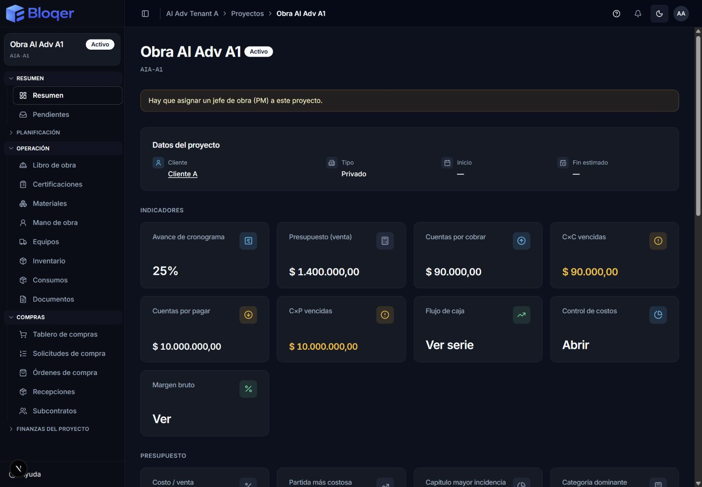
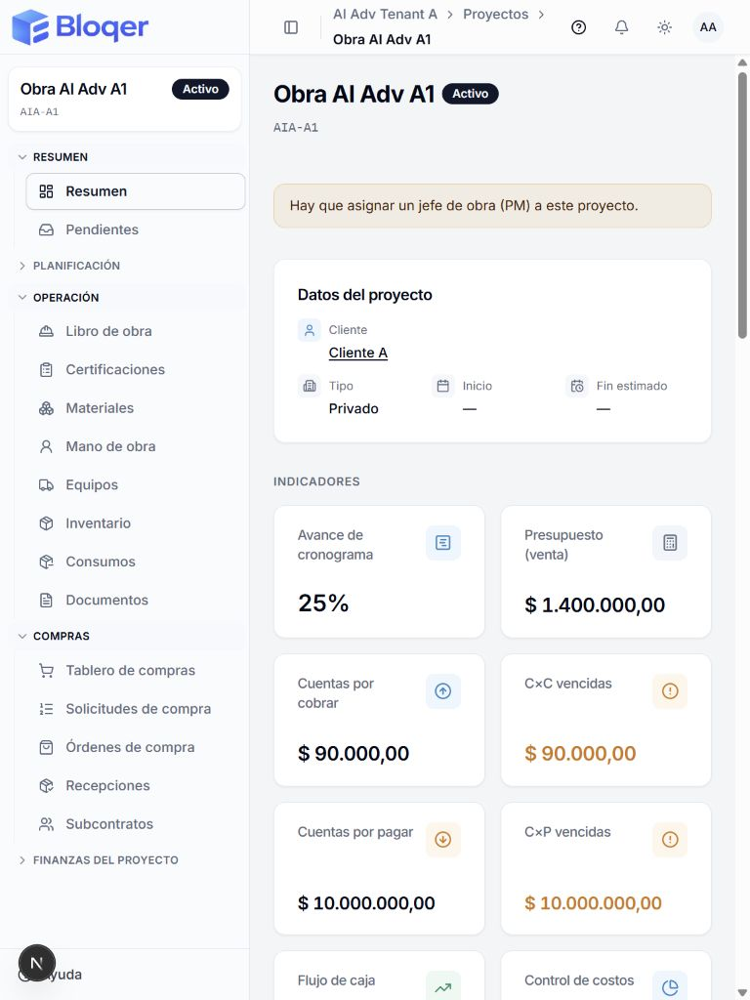
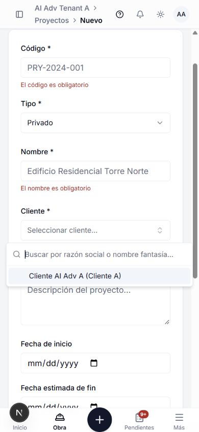
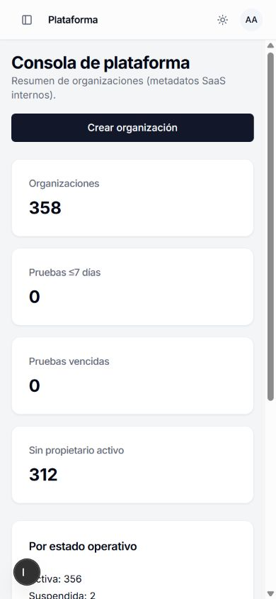
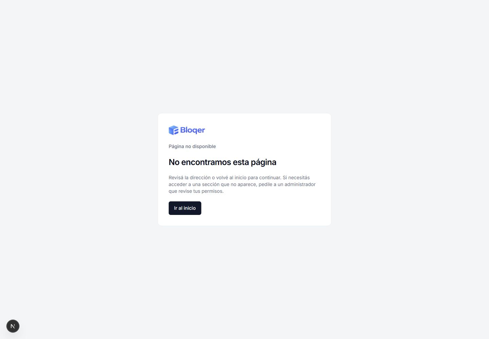

# Referencia visual reutilizable — AG-02

Capturas reales del 03/11/2026 sobre el árbol local de la corrida [AG-02](./2026-11-03-ag-02-navigation-visual-system.md), con datos sintéticos de la base aislada de AG-01. Son ejemplos de composición y controles. No certifican todos los módulos ni sustituyen la prueba de su comportamiento. Las cifras de los fixtures no son una referencia financiera.

## Patrones vigentes

- La implementación compartida permanece en `apps/web/components/ui`, `components/layout`, `features/shell` y `app/globals.css`. Reutilizar PageShell/PageListHeader, superficies y controles existentes antes de crear variantes.
- El menú depende de rol, empresa/proyecto actual y gates vigentes. Breadcrumbs enlazan pantallas existentes. Estado activo, IDs de paneles y salto al contenido deben ser accesibles.
- Encabezados permiten envolver títulos y acciones. Las cards conservan lectura en teléfono; las tablas anchas desplazan dentro de su panel sin ensanchar el documento. Encabezados ordenables mantienen nombre accesible y no invaden otra celda.
- Formularios vinculan etiquetas, controles y errores; preservan foco, búsqueda y mensajes es-AR. En teléfono, campos que requieren ancho se apilan. Los selectores dejan margen al viewport y el menú puede desplazarse.
- Dialog/AlertDialog tienen margen y scroll dentro del alto disponible. Sheet respeta el viewport. Confirmaciones evitan doble envío y permiten otro intento tras un fallo; verificar los consumidores que usan pending externo.
- Carga, vacío, acceso denegado, error y éxito se distinguen. Un vacío no invita a operaciones sin permiso. No mostrar detalles internos del error. El inicio de la consola SaaS es `/platform`.
- Conservar contraste normal de texto de al menos 4,5:1 en las combinaciones usadas. Los 26 pares medidos en esta corrida cumplen, mínimo 4,625:1; otros colores/estados requieren su propia medición. El rojo cambia de luminancia entre temas y conserva su significado.

## Ejemplos comprobados

### Proyecto, escritorio oscuro, VIEWER — 1440×1000

Shell contextual completo, resumen, metadatos y KPI. El rol de lectura no muestra acciones de edición.

### Proyecto, tablet clara, VIEWER — 768×1024

Los metadatos se reacomodan para que Tipo y fechas conserven espacio dentro del panel.

### Formulario y buscador, teléfono claro, OWNER — 390×844

Validación vacía, etiquetas asociadas, foco y selector de cliente limitado al viewport. La captura no representa una alta guardada.

### Consola SaaS, teléfono claro, propietario sintético autorizado — 390×844

Navegación propia, sin barra de campo ni espacio inferior reservado para ella.

### Recuperación de ruta inexistente, claro — 1440×1000

Mensaje en español y acción para continuar.

## Revalidar un área después de cambiarla

1. Identificar controles/DTO/gates compartidos afectados y recuperar los IDs del informe si corresponde.
2. Recorrer la sección con rol que pueda operar y rol de lectura; verificar también entrada directa y vacío.
3. Revisar 390×844, 430×932, 768×1024 y 1440×1000, ambos temas en los consumidores alterados. Probar overlay con 390×400 y reflow con 720×500. Ese reflow no reemplaza zoom nativo ni lector de pantalla.
4. Abrir/cerrar con teclado, comprobar foco y nombres accesibles; ensayar error/reintento relevante con las pruebas mantenidas del área, sin mutar producción.
5. Registrar ruta, rol, estado, viewport y revisión junto con capturas actuales. No reutilizar una captura histórica como evidencia de la revisión nueva.
6. Actualizar Guía/Ayuda/AI si cambian los pasos visibles; documentar límites de publicación y cobertura por separado.
